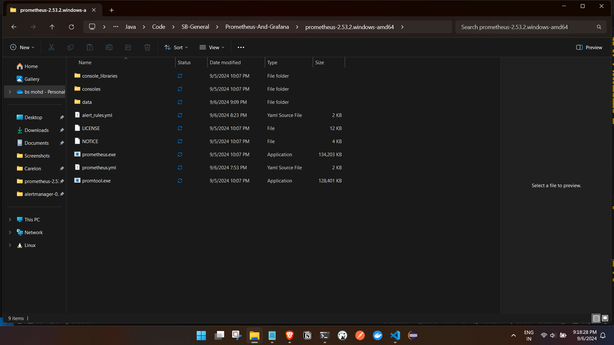
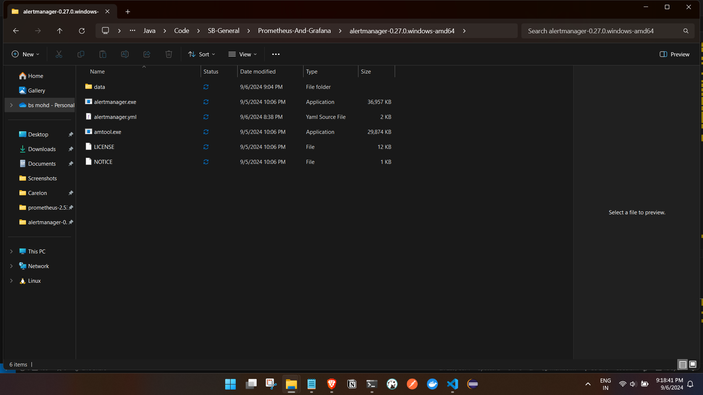
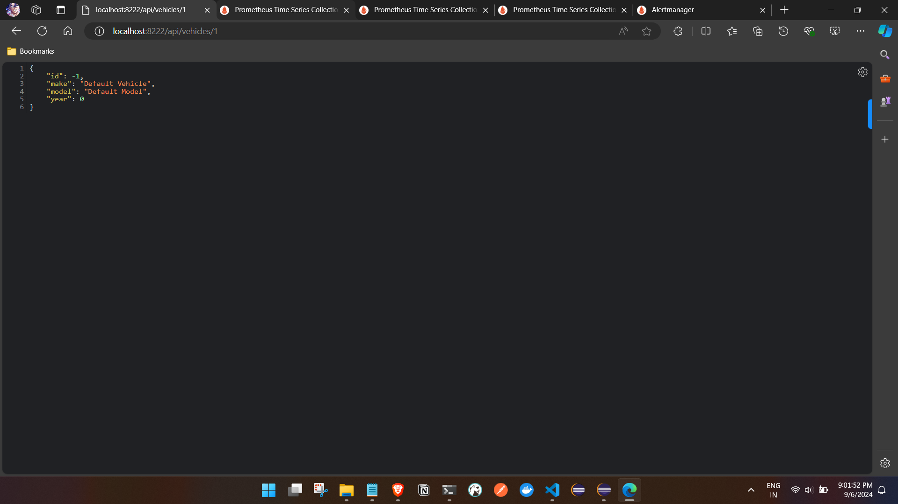
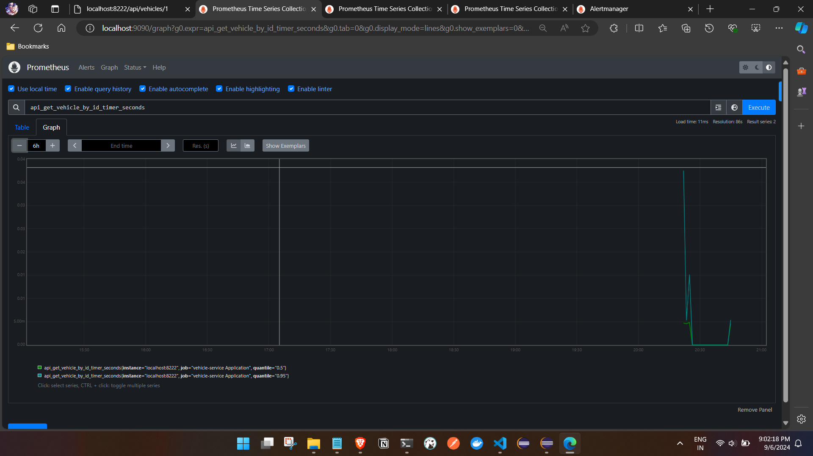
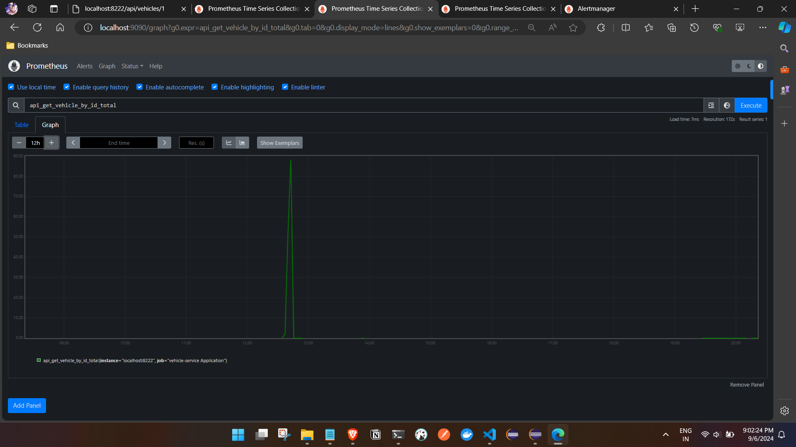
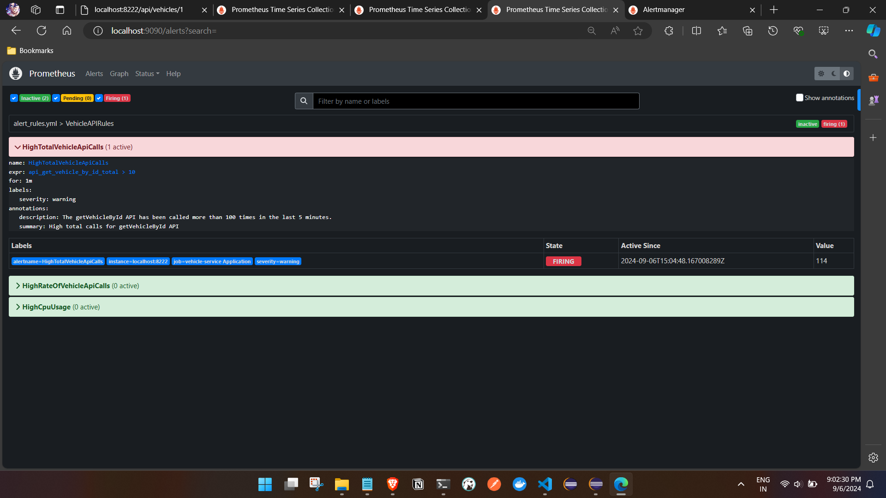
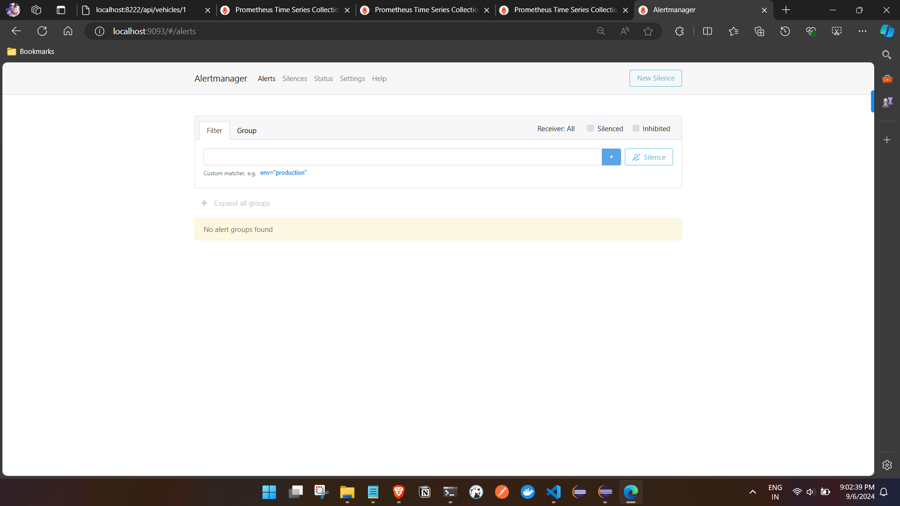
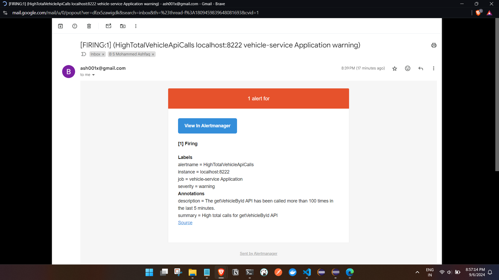

# prometheus mail alert set up demo :

Create a project and add actuator and prometheus dependencies to your projectL:\
```
        <dependency>
			<groupId>io.micrometer</groupId>
			<artifactId>micrometer-registry-prometheus</artifactId>
			<scope>runtime</scope>
		</dependency>


        <dependency>
			<groupId>org.springframework.boot</groupId>
			<artifactId>spring-boot-starter-actuator</artifactId>
		</dependency>
```

- update the application.properties file : 
```
# Actuator settings
management.endpoints.web.exposure.include=*
management.endpoint.health.show-details=always

server.port=8222
```

- Creating a custom configuration for prometheus:
```

@RestController
@RequestMapping("/api/vehicles")
public class VehicleController {

	@Autowired
	private VehicleService vehicleService;

	// Custom counters for tracking total and rate of API calls
	private final Counter getVehicleByIdTotalCounter;
	private final Timer getVehicleByIdTimer;

	@Autowired
	public VehicleController(VehicleService vehicleService, MeterRegistry meterRegistry) {
		this.vehicleService = vehicleService;

		// Counter for total API calls
		this.getVehicleByIdTotalCounter = Counter.builder("api.get.vehicle.by.id.total")
				.description("Total number of calls to getVehicleById API").register(meterRegistry);

		// Timer for tracking call rate
		this.getVehicleByIdTimer = Timer.builder("api.get.vehicle.by.id.timer")
				.description("Timer for getVehicleById API call rate").publishPercentiles(0.5, 0.95) // Publish
																										// percentiles
																										// (optional)
				.register(meterRegistry);
	}

	
	@GetMapping("/{id}")
	public ResponseEntity<Vehicle> getVehicleById(@PathVariable Long id) {
		getVehicleByIdTotalCounter.increment(); // Increment total counter

		// Timer to measure the duration and count calls per minute
		return getVehicleByIdTimer.record(() -> {
			return vehicleService.getVehicleById(id).map(ResponseEntity::ok).orElseGet(() -> {
				// Return a default Vehicle object if not found
				Vehicle defaultVehicle = new Vehicle();
				defaultVehicle.setId(-1L); // Example: set an ID to indicate a default object
				defaultVehicle.setMake("Default Vehicle"); // Example default values
				defaultVehicle.setModel("Default Model");
				defaultVehicle.setYear(0);
				// Add any other default properties here

				return ResponseEntity.ok(defaultVehicle);
			});
		});
	}

}

```

--download prometheus and alertmanager :
link : https://prometheus.io/download/

-Setting up prometheus with alerts : 

```

# my global config
global:
  scrape_interval: 15s # Set the scrape interval to every 15 seconds. Default is every 1 minute.
  evaluation_interval: 15s # Evaluate rules every 15 seconds. The default is every 1 minute.
  # scrape_timeout is set to the global default (10s).

# Alertmanager configuration
alerting:
  alertmanagers:
    - static_configs:
        - targets:
          - localhost:9093 # Set the alertmanager ip with port as its running in localhost.

# Load rules once and periodically evaluate them according to the global 'evaluation_interval'.
rule_files:
  - 'alert_rules.yml' # provide the alerts file
  # - "second_rules.yml"

# A scrape configuration containing exactly one endpoint to scrape:
# Here it's Prometheus itself.
scrape_configs:
  # The job name is added as a label `job=<job_name>` to any timeseries scraped from this config.
  - job_name: "prometheus"

    # metrics_path defaults to '/metrics'
    # scheme defaults to 'http'.

    static_configs:
      - targets: ["localhost:9090"]
  

  - job_name: "vehicle-service Application"
    metrics_path: "/actuator/prometheus"
    scrape_interval: 5s
    static_configs:
      - targets: ["localhost:8222"]


Alerts Configuration: 
Create a yml file in same directory as the prometheus configuration.


add this configuration in the yml file :


groups:
  - name: VehicleAPIRules
    rules:
      # Alert for total calls exceeding a threshold
      - alert: HighTotalVehicleApiCalls
        expr: api_get_vehicle_by_id_total > 10 #for testing 10
        for: 1m
        labels:
          severity: warning
        annotations:
          summary: "High total calls for getVehicleById API"
          description: "The getVehicleById API has been called more than 100 times in the last 5 minutes."

      # Alert for high rate of calls per minute
      - alert: HighRateOfVehicleApiCalls
        expr: rate(api_get_vehicle_by_id_timer_count[1m]) > 10 #test the qry in prometheus dashboard and add here 
        for: 1m
        labels:
          severity: critical
        annotations:
          summary: "High rate of calls for getVehicleById API"
          description: "The getVehicleById API call rate is more than 10 requests per minute."

      # Alert for high CPU usage
      - alert: HighCpuUsage
        expr: system_cpu_usage{instance="localhost:8222", job="vehicle-service Application"} > 0.5
        for: 2m
        labels:
          severity: critical
        annotations:
          summary: "High CPU Usage Alert"
          description: "CPU usage is above 50% on instance 'localhost:8222' for more than 2 minutes."

```


- Setting up the Alertmanager :
```


# # Mail alert Configuration template: 
# # Values should be in single quotes and from can be any name.

# global:
#   smtp_smarthost: 'localhost:25'
#   smtp_from: 'Alertmanager@example.com'
#   smtp_auth_username: ''
#   smtp_auth_password: ''
#   smtp_require_tls: false  #Add this line to disable TLS requirement i,e http
  

# # email will work for  outlook as well.
# route:
#   receiver: 'email'
#   repeat_interval: 1h #Resend notification after 1 hour


# # Receivers configuration 
# receivers:
# - name: 'email'
#   email_configs:
#   - to: 'admin@example.com'


<!-- Gmail sample  -->

global:
  smtp_smarthost: 'smtp.gmail.com:587'  # Gmail SMTP server and port for TLS
  smtp_from: 'alertManagermail@mail.com'  # Your Gmail address
  smtp_auth_username: 'ash001x@gmail.com'  # Your Gmail address
  smtp_auth_password: ''  # App password from google account link : https://myaccount.google.com/apppasswords give a app name it gives pass add here 
  smtp_require_tls: true  # Enable TLS for secure connection

route:
  receiver: 'email'
  repeat_interval: 1h  # Resend notification after 1 hour

receivers:
  - name: 'email'
    email_configs:
      - to: 'ash001x@gmail.com'  # Replace with the recipient's email address


```

- Files overview :






- UI : 
api : http://localhost:8222/api/vehicles/1
- Promethus 






- Alert manager : 


- When the alert is triggered :



